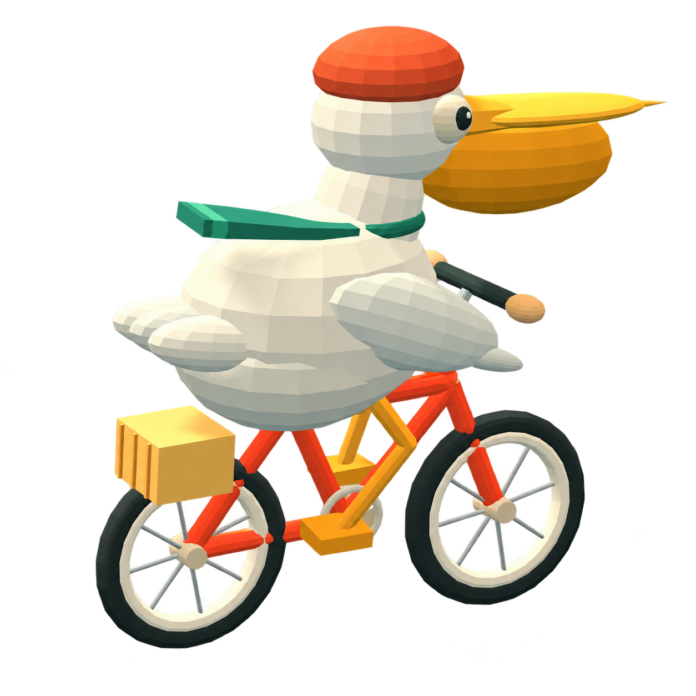
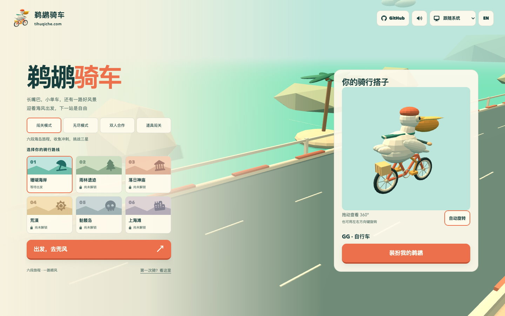
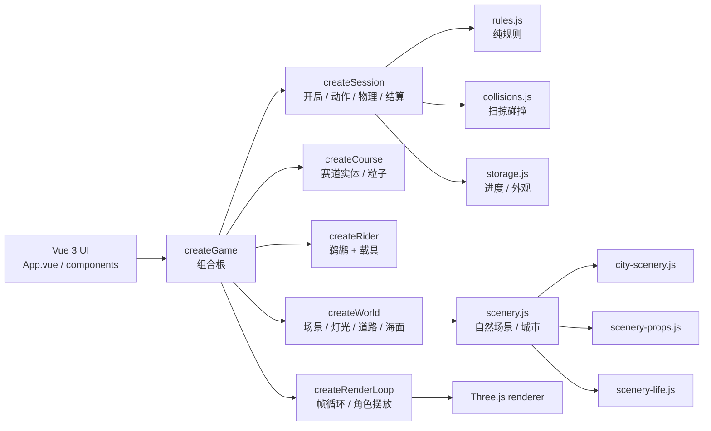

<div align="center">



# 鹈鹕骑车 · Pelican Pedal Run

**长嘴巴，小单车，还有一路城市与海岛。**

一个用 **Vue 3 + Vite 8 + Three.js / WebGL** 写成的 3D 骑车闯关游戏：自动向前骑行，变道、跳跃、低头躲开障碍，沿途收集小鱼，骑过海岸、雨林、神庙、荒漠、骷髅岛，以及上海、东京、巴黎、伦敦、纽约、悉尼和迪拜。

[](https://tihuqiche.com/)
[](https://tihuqiche.com/en/)
[](https://tihuqiche.com/offline.html)
[](https://flying-dragon-ai.github.io/tihuqiche/)

[](https://github.com/flying-dragon-ai/tihuqiche/stargazers)
[](https://github.com/flying-dragon-ai/tihuqiche/network/members)
[](LICENSE)
[](https://github.com/flying-dragon-ai/tihuqiche/commits/main)
[](package.json)
[](package.json)
[](package.json)
[](package.json)
[](package.json)
[](eslint.config.js)
[](knip.json)




</div>

> 在线地址在首次 Pages 部署成功后可用；下载 `offline.html` 后用浏览器打开，即可离线游玩。

---

## 目录

- [为什么是鹈鹕](#为什么是鹈鹕)
- [核心特性](#核心特性)
- [四种模式](#四种模式)
- [十二条路线](#十二条路线)
- [操作方式](#操作方式)
- [快速开始](#快速开始)
- [构建与离线包](#构建与离线包)
- [测试](#测试)
- [项目结构](#项目结构)
- [架构一览](#架构一览)
- [代码质量](#代码质量)
- [存档与设置](#存档与设置)
- [成绩分享](#成绩分享)
- [部署到 GitHub Pages](#部署到-github-pages)
- [Star 历史](#star-历史)
- [贡献者](#贡献者)
- [社区与许可证](#社区与许可证)

---

## 为什么是鹈鹕

因为长嘴、短腿、圆身体，骑上一辆小单车之后，所有物理常识都会变得很好笑。

但这不是一个只靠造型撑场面的 demo。项目把“能玩”放在第一位：

- **真 3D**：鹈鹕、单车、海岛赛道、追随镜头、阴影和粒子都是 Three.js 场景里的真实对象。
- **真规则**：冲刺逐条消耗小鱼，护盾只挡一次伤害，双人各自计分，星级由满血和鱼量共同决定。
- **真离线**：构建会生成一个内嵌 CSS、JavaScript、Logo、favicon、装扮图片和 3D 引擎的 `offline.html`，双击就能玩。
- **真可维护**：规则、碰撞、存档、渲染、场景、角色分层；纯逻辑可以脱离浏览器做单元测试。

---

## 核心特性

|     | 能力           | 说明                                                                                                |
| --- | -------------- | --------------------------------------------------------------------------------------------------- |
| 🚴  | **3D 骑行**    | 鹈鹕、单车、海岛赛道与追随镜头；自行车包含脚蹬、曲柄、前后链轮与闭合链条，踩踏和传动联动            |
| 🛣️  | **三条车道**   | 矮木栏需要跳跃，高木箱需要绕开，蓝色横杆需要低头                                                    |
| 🐟  | **小鱼与冲刺** | 收集小鱼；有 1 条可用小鱼即可开启连续冲刺，速度 +50%，每秒消耗 4 条，耗尽自动停止                   |
| 🛡️  | **金色护罩**   | 旋转金环与闪光，挡一次伤害；车尾喷火与两侧风线显示冲刺状态                                          |
| 🎮  | **四种模式**   | 闯关、无尽、电脑本地双人合作、道具闯关                                                              |
| 🏁  | **十二关**     | 每关独立解锁、最高分与三星评价；普通、双人、道具分别保存                                            |
| 👕  | **免费装扮**   | GG/MM、皮肤、帽子、围巾、眼镜、衣服；自行车、摩托车、电瓶车、滑板车、三轮自行车、小汽车、货车、飞机 |
| 🖥️  | **双端操作**   | 键盘、触屏滑动、手机屏幕按钮；双人仅支持电脑本地键盘                                                |
| 🌏  | **中英双语**   | 跟随系统语言与明暗主题，手动选择保存在当前浏览器                                                    |
| 📦  | **单文件离线** | 在线版按资源文件加载；离线版一个 HTML 文件即可运行                                                  |
| 🧪  | **可验证**     | 102 个 Node 单元测试 + 545 项 Playwright 浏览器检查                                                 |

---

## 四种模式

| 模式         | 玩法                                                                                                                                | 存档                         |
| ------------ | ----------------------------------------------------------------------------------------------------------------------------------- | ---------------------------- |
| **闯关**     | 12 关依次解锁，到达终点通关；满血 +1 星，累计至少 25 条鱼 +1 星                                                                     | 每关最高分、星级、解锁进度   |
| **无尽**     | 初始 3 点体力，5000 米内速度从 18 增至 32 m/s，障碍间距从 36 缩至 28 米，每 1000 米循环切换十二种主题                               | 独立最高分                   |
| **双人合作** | 同一块屏幕、共用三条车道，各自 3 点体力、鱼池和冲刺；差距超过 10 米时落后者逐步获得追赶加成，18 米达到 50%，与冲刺合计倍率上限 1.75 | 合作通关、个人成绩与团队总分 |
| **道具闯关** | 道具箱只在空槽时拾取，四类等概率：护盾、磁铁、双倍鱼分、清障波                                                                      | 与普通闯关分开保存           |

### 道具

| 道具        | 效果                                       |
| ----------- | ------------------------------------------ |
| 🛡️ 护盾     | 挡一次伤害；已有护盾时不消耗槽内护盾       |
| 🧲 磁铁     | 持续 8 秒，吸前方 12 米三道鱼              |
| ✨ 双倍鱼分 | 持续 8 秒，每鱼额外 +25 分；不增加可用鱼量 |
| 💥 清障波   | 清除前方 30 米障碍                         |

同类限时道具刷新至 8 秒，不叠加时长。

### 计分

单人得分为：

```text
floor(距离) + 累计小鱼 × 25 + 道具额外分 + 完赛时剩余体力 × 150
```

无尽模式不加体力奖励；双人分别计分后相加，倒下者无通关奖励。

---

## 十二条路线

| 关卡 | 路线         | 距离    |
| ---- | ------------ | ------- |
| 01   | 珊瑚海岸     | 600 米  |
| 02   | 雨林遗迹     | 850 米  |
| 03   | 落日神庙     | 1100 米 |
| 04   | 荒漠         | 1250 米 |
| 05   | 骷髅岛       | 1400 米 |
| 06   | 上海滩       | 1600 米 |
| 07   | 东京樱花道   | 1650 米 |
| 08   | 巴黎塞纳河   | 1700 米 |
| 09   | 伦敦泰晤士河 | 1750 米 |
| 10   | 纽约自由之路 | 1800 米 |
| 11   | 悉尼海港     | 1850 米 |
| 12   | 迪拜天际线   | 1900 米 |

到达终点即可通关，保留 3 点体力并收集至少 25 条小鱼可获得三星；体力用尽可以重新挑战本关。

---

## 操作方式

| 操作        | 键盘                                     | 触屏                     |
| ----------- | ---------------------------------------- | ------------------------ |
| 左右变道    | `←` / `→` 或 `A` / `D`                   | 左右滑动，或点击方向按钮 |
| 跳跃        | `↑` 或 `W`                               | 向上滑动，或点击跳跃按钮 |
| 低头        | `↓` 或 `S`                               | 向下滑动，或点击低头按钮 |
| 冲刺        | `空格` 开启或停止，需要至少 1 条可用小鱼 | 点击冲刺 / 停止冲刺      |
| 使用道具    | `E`，仅道具模式                          | 点击道具按钮             |
| 暂停 / 继续 | `P` 或 `Esc`                             | 点击暂停 / 继续按钮      |
| 音效        | 点击右上角音效开关                       | 点击右上角音效开关       |

### 双人键位

| 操作       | P1          | P2                             |
| ---------- | ----------- | ------------------------------ |
| 左右变道   | `A` / `D`   | 小键盘 `4` / `6`，或 `←` / `→` |
| 跳跃、低头 | `W` / `S`   | 小键盘 `8` / `2`，或 `↑` / `↓` |
| 冲刺       | `空格`      | 小键盘 `0`，或右 `Shift`       |
| 暂停       | `P` / `Esc` | `P` / `Esc`                    |

双人仅支持电脑和本地键盘，手机入口显示电脑支持提示；小键盘按物理键位识别，兼容 NumLock 开关，不需要联网或账号。

---

## 快速开始

需要 **Node.js 22.12 或更高版本** 和 **pnpm 11.24.0**，CI 使用 Node.js 24。

```bash
git clone https://github.com/flying-dragon-ai/tihuqiche.git
cd tihuqiche
corepack enable
pnpm install --frozen-lockfile
pnpm dev
```

开发服务器支持 Vue 单文件组件热更新。

```bash
pnpm build     # 在线资源 + 中英文预渲染 + 离线单文件
pnpm preview   # 预览构建产物
```

构建完成后：

- 中文首页：`dist/index.html`
- 英文首页：`dist/en/index.html`
- 离线单文件：`dist/offline.html`

在线版需要通过 HTTP 服务访问；离线版可以直接双击打开。

---

## 构建与离线包

构建分三步：

1. 生成在线资源；
2. 用 Vue 服务端渲染输出中文 `dist/index.html` 和英文 `dist/en/index.html`；
3. 用 `vite-plugin-singlefile` 生成完整内嵌的 `dist/offline.html`。

在线 Logo 与全部装扮 PNG 使用含内容 hash 的独立文件 URL，便于浏览器缓存复用；离线版继续内嵌全部图片。

基础 HTML 内置品牌加载界面，Vue 挂载期间保持显示；程序下载阶段展示加载动画，之后按实际完成的资源任务推进进度，等待项目 Logo、全部装扮图片解码、必需样式和 3D 首帧就绪再显示游戏。

游戏入口脚本与构建样式通过 `data-boot-required` 标记为必需资源，启动只等待必需样式，不等待整个页面的 `load`；Cloudflare 等可选统计脚本下载失败仅保留控制台警告，不阻断启动或已显示的游戏。

标题、描述、关卡名称和 JSON-LD 与界面共享 `src/locales.js`、`src/levels.js`；两种语言的静态 HTML 都包含实际页面内容、canonical、hreflang、Open Graph 与 Twitter Card，不依赖执行 JavaScript 才能抓取。

`public/` 提供 favicon、1200×630 分享图片、`robots.txt` 和 `sitemap.xml`。构建会检查预渲染内容、在线图片文件与离线资源引用；在线 HTML 仅简短引用 `dist/LICENSE.txt`，该文件包含项目和 Three.js 的 MIT 许可证，离线单文件仍携带完整许可说明。

### 素材生成

```bash
pnpm assets          # 从现有 Logo 重新生成 favicon 和分享图片
pnpm assets:outfits  # 用当前 Three.js 角色模型重新生成装扮缩略图
pnpm share:qr        # 重新生成分享二维码
```

`pnpm assets` 需要已安装 Playwright Chromium；使用本机 Chrome 时运行 `PLAYWRIGHT_CHANNEL=chrome pnpm assets`。

装扮缩略图使用当前 Three.js 程序化角色模型生成，26 张透明底 128px PNG 位于 `src/assets/outfits/`，总计约 205 KiB；`src/outfit-thumbnails.js` 通过 `?inline` 导入，离线页面无需请求额外图片，七个分类复用对应代表款式。

修改模型或装扮目录后，按需运行 `pnpm assets:outfits`；脚本只使用现有 Vite、Three.js、Playwright 依赖和已安装的 Google Chrome，在隔离的无头上下文中用一个渲染器生成素材，不读取用户浏览器资料。

---

## 测试

提交前建议先跑 `pnpm format:check && pnpm lint`；废弃代码扫描用 `pnpm deadcode:check`，完全未使用的 `src/` 文件用 `pnpm deadcode:files` 查看。

```bash
pnpm install --frozen-lockfile
pnpm exec playwright install chromium
pnpm test
```

`pnpm test` 按 **模块测试 → 构建 → 浏览器测试** 顺序执行：

- `pnpm test:unit`：只运行 Node 模块测试，不写入 `dist`；
- `node tests/game.cjs`：用 Playwright 检查在线与离线加载、十二关流程、存档迁移、键盘与触屏、主题和语言切换、预渲染 SEO、favicon 与分享资源，以及手机竖屏和横屏布局。

如果本机已安装 Google Chrome，也可以使用已有浏览器：

```bash
PLAYWRIGHT_CHANNEL=chrome pnpm test
```

构建后可以单独检查启动流程：

```bash
PLAYWRIGHT_CHANNEL=chrome node tests/startup.cjs
```

测试报告和截图写入 `test-results/`，不提交到 Git；测试使用独立浏览器上下文，不修改玩家实际存档。

真实键盘多键同时按下、双人手感和手机截图扫码需要人工验收，浏览器模拟不能代替这些结论。

---

## 项目结构

```text
.
├── src/
│   ├── App.vue / main.js          # Vue 应用与浏览器入口
│   ├── game.js                    # 组合根：世界、角色、课程、会话、渲染循环
│   ├── game-session.js            # 开局、暂停、结算、动作、物理步进
│   ├── game-render.js             # 帧循环、角色摆放、HUD 节流
│   ├── game-preview.js            # 首页 / 装扮预览控制器
│   ├── game-theme.js              # 主题切换
│   ├── game-camera.js             # 追随镜头与双人标记
│   ├── rules.js                   # 纯规则：计分、星级、冲刺、道具
│   ├── collisions.js              # 扫掠碰撞与拾取判定
│   ├── storage.js                 # 进度、外观、迁移与损坏保护
│   ├── course.js                  # 赛道实体、流式生成与粒子
│   ├── course-entities.js         # 障碍 / 小鱼 / 道具模型
│   ├── course-markers.js          # 辅助标记贴图
│   ├── course-particles.js        # 爆发粒子
│   ├── world.js                   # 场景、灯光、道路、海面、终点门
│   ├── scenery.js                 # 自然场景与城市天际线
│   ├── city-scenery.js            # 东京塔、埃菲尔、大本钟、自由女神、悉尼歌剧院、哈利法塔
│   ├── scenery-props.js           # 海岸、雨林、神庙、荒漠、骷髅岛细节
│   ├── scenery-life.js            # 行人、飞鸟、红绿灯、口袋公园
│   ├── rider.js                   # 鹈鹕 + 载具组合与动画
│   ├── rider-vehicle.js           # 八种载具
│   ├── rider-accessories.js       # 帽子、围巾、眼镜、衣服、身份
│   ├── rider-effects.js           # 护盾、喷火、火花
│   ├── components/                # 菜单、HUD、操作、弹窗、装扮
│   ├── composables/               # useToast / useWardrobe
│   ├── styles/                    # 明暗主题与响应式布局
│   ├── assets/                    # Logo 与装扮缩略图
│   ├── entry-server.js            # 中英文页面预渲染入口
│   ├── seo.js / locales.js        # 共享元信息与双语文案
│   └── levels.js                  # 十二关配置
├── public/                        # favicon、分享图、robots、sitemap
├── scripts/
│   ├── build.mjs                  # 在线、预渲染与离线构建
│   ├── generate-social-assets.mjs # 从 Logo 生成分享资源
│   ├── generate-outfit-thumbnails.mjs
│   ├── generate-share-qr.mjs
│   └── find-unused.mjs            # 安全扫描 / 删除完全未使用的 src 文件
├── tests/                         # Node 单元测试 + Playwright 浏览器检查
├── docs/preview.png               # 游戏预览
├── docs/architecture.md           # 目录规范与死代码清理流程
├── vendor/three/                  # Three.js 原始许可证
├── .github/workflows/pages.yml    # 构建和部署
├── eslint.config.js               # ESLint + unused-imports
├── knip.json                      # 未使用文件 / export / 依赖扫描
├── package.json
├── pnpm-lock.yaml
└── LICENSE
```

---

## 架构一览



设计上刻意把“规则”和“渲染”分开：

- `rules.js` 不依赖 Three.js、DOM 或 Vue，可以直接在 Node 里测试；
- `collisions.js` 只处理扫掠接触、拾取优先级和伤害；
- `game-session.js` 负责把规则、碰撞、存档和音效串起来；
- `game-render.js` 只关心每帧怎么摆角色、怎么推进镜头；
- `world.js` / `scenery*.js` 负责一次性建场景，并在销毁时统一释放 GPU 资源。

---

## 代码质量

这个仓库按“下一位读者能不能少骂一句”的标准维护：

- **Prettier** 统一格式：`pnpm format` / `pnpm format:check`；
- **ESLint + unused-imports** 拦截未使用变量和 import：`pnpm lint` / `pnpm lint:fix`；
- **Knip** 定期扫描未使用文件、export 和依赖：`pnpm deadcode:check`；
- **安全删除**：`pnpm deadcode:files` 只报告 `src/` 下完全未使用的文件，确认后加 `-- --delete` 才真正删除；
- **纯函数优先**：计分、星级、冲刺消耗、道具效果、存档迁移都能脱离浏览器测试；
- **短函数与单一职责**：长工厂拆成 `createWorld`、`createSession`、`createRenderLoop`、`createPreviewController` 等组合单元；
- **错误处理显式**：存档损坏、存储不可用、音频初始化失败、剪贴板不可用都会给出明确提示，不静默回退；
- **资源生命周期明确**：场景、角色、粒子、贴图、音频都有对应的 `dispose` 路径；
- **测试覆盖行为**：102 个单元测试 + 545 项浏览器检查，覆盖规则、迁移、碰撞、载具、场景、触屏、主题、语言和离线启动。

```bash
pnpm lint                       # ESLint + unused-imports
pnpm lint:fix                   # 自动修复可修复项
pnpm deadcode:check              # Knip 全量报告：文件 / export / 依赖
pnpm deadcode:report             # 输出 JSON 报告到 deadcode-report.json
pnpm deadcode:files              # 只报告 src/ 下完全未使用的文件
pnpm deadcode:files -- --delete  # 确认后删除
```

项目是 JavaScript + Vue SFC，没有 TypeScript 编译链；Knip 直接支持 JS/Vue，能同时报告未使用文件、export 和依赖，比 `ts-unused-exports` 更贴合当前仓库。CI 在构建前会跑 `pnpm deadcode:check`，本地也可以随时运行。目录职责和清理流程见 [docs/architecture.md](docs/architecture.md)。

> “好代码首先是给人读的，其次才是给机器执行的。”——把这句话落到仓库里，就是格式化、命名、分层、测试，以及定期把没用的东西删掉。

---

## 存档与设置

存档属于当前浏览器和访问地址，本地文件与在线网站的进度互相独立；浏览器禁止本地存储时，游戏会提示无法保存进度。

| 键                            | 内容                                               |
| ----------------------------- | -------------------------------------------------- |
| `pelican-pedal-run-v3`        | 闯关、双人、道具、无尽的进度与最高分               |
| `pelican-pedal-appearance-v1` | P1 / P2 装扮，只在主动保存时写入                   |
| `pelican-game-settings-v1`    | 音效风格、音量、辅助箭头、加速风线、动态场景、阴影 |
| `pelican-locale`              | 手动选择的语言                                     |
| `pelican-theme`               | 手动选择的明暗主题                                 |

进度按 `v3 → v2 → v1` 读取，只有键不存在才查旧版；旧成绩仅迁入普通闯关，三关旧档已通关落日神庙时解锁荒漠；原有六关 v3 记录保留并扩展到十二关，已完成上海滩时解锁东京；加载不写盘，首次有效结算写入 v3，保留原 v1/v2 键。

损坏进度会明确提示并禁止本次自动覆盖，不悄悄回退到旧档；存储失败时本局结果和分享仍可用，但不会提示保存成功；玩家可通过浏览器站点数据管理显式清除损坏存档后重新开始。

游戏设定单独保存在 `pelican-game-settings-v1`，调整即生效并保存；音效可选经典、街机、铃音和柔和四种本地合成风格，音量与静音立即作用于正在播放的声音；关掉辅助箭头只隐藏操作提示，道具箱仍保留识别标记；动态场景可隐藏飞鸟与人物、停止路边动画，阴影可独立关闭；这些选项不改变游戏速度、碰撞和计分，存储失败会明确提示本次生效但未保存。

---

## 成绩分享

结算卡展示同一份冻结结果，落盘分数与复制文案保持一致；按钮在截图区域外，可直接使用系统截图；复制失败会显示错误和可手动选中的文本，不承诺所有浏览器离线剪贴板可用。

二维码内联到离线包中，中文指向 `https://tihuqiche.com/`、英文指向 `https://tihuqiche.com/en/`，不会分享本地文件地址；离线可显示二维码，访问官网仍需要网络，链接不上传或还原个人成绩。

二维码由开发依赖 `qrcode` 生成真实 SVG，运行时不加载二维码库或第三方资源；修改正式地址后运行 `pnpm share:qr`，重新生成 `src/share-qr.js` 并独立扫码核对。

---

## 部署到 GitHub Pages

工作流位于 [`.github/workflows/pages.yml`](.github/workflows/pages.yml)，使用 GitHub 官方 Pages Actions：

- 推送到 `main`：安装依赖 → 执行 `pnpm format:check` → 执行 `pnpm lint` → 执行 `pnpm deadcode:check` → 执行 `pnpm build` → 上传 `dist/` → 部署到 Pages；
- 向 `main` 提交 Pull Request：仅构建，不部署；
- 需要重新部署时，可在 Actions 中选择 **Build and deploy Pages → Run workflow**，使用 `main` 分支运行。

首次配置或 Fork 仓库后，进入 **Settings → Pages → Build and deployment → Source**，选择 **GitHub Actions**；不需要创建 `gh-pages` 分支，也不需要配置个人访问令牌。

正式访问地址为 **[https://tihuqiche.com](https://tihuqiche.com/)**，通过 GitHub Pages 托管。在 **Settings → Pages → Custom domain** 中填写 `tihuqiche.com`，DNS 校验和证书准备完成后开启 **Enforce HTTPS**。

中文规范地址为 `https://tihuqiche.com/`，英文为 `https://tihuqiche.com/en/`；分享图片使用可直接抓取的 `https://tihuqiche.com/share-image.png`，这些元信息不会使离线包发起资源请求。

每次部署都会从 `src/` 重新构建，只发布 `dist/` 内的静态产物；构建失败时停止部署，线上版本保持不变。

---

## Star 历史

<div align="center">

<a href="https://star-history.com/#flying-dragon-ai/tihuqiche&Date">
  
</a>

</div>

---

## 贡献者

<div align="center">

<a href="https://github.com/flying-dragon-ai/tihuqiche/graphs/contributors">
  
</a>

</div>

---

## 社区与许可证

- 社区支持：[LinuxDO](https://linux.do)
- 上游项目：[Licoy/tihuqiche](https://github.com/Licoy/tihuqiche)；本仓库是整理与优化后的副本
- 项目使用 [MIT License](LICENSE)
- Three.js `0.160.1` 使用其原始 [MIT License](vendor/three/LICENSE)

<div align="center">

**如果这只长嘴鸟让你笑了一下，点个 Star 再走。**

[](https://github.com/flying-dragon-ai/tihuqiche/stargazers)

</div>
